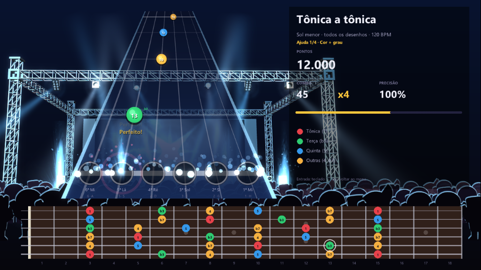

# Guitar Play

Jogo estilo Guitar Hero para aprender pentatônicas na guitarra, seguindo a estrutura de estudo do ebook
*Pentatônicas* (Pedro Bernardi): cada capítulo vira um mundo, cada exercício um nível, e só se avança com estrelas.

Feito em C# com MonoGame (.NET 8).

## Rodar

```bash
dotnet run --project GuitarPlay
```

## Mundos (um por capítulo do livro)

| Mundo | Capítulo | Níveis |
|---|---|---|
| 1 · Os 5 desenhos | 1 | Desenhos 1 a 5 de Sol menor |
| 2 · Pentatônica maior | 2 | Desenhos 2, 3, 4, 5 e 1 de Sol maior (ordem do braço) + Menor ↔ Maior na mesma região |
| 3 · Recortes de oitava | 3 | Tônica a tônica, terça a terça e quinta a quinta, em menor e maior, em todos os desenhos |
| 4 · Transições entre desenhos | 4 | Cada par de desenhos vizinhos, trocando de desenho em cada uma das 6 cordas, grave → agudo e agudo → grave |
| 5 · Pares de cordas | 5 | Cada par de cordas vizinhas atravessando os 5 desenhos na horizontal, em menor e maior |
| 6 · Bends | 6 | Por desenho: bends isolados (nota-alvo presa, depois o bend até ela) e bends na escala (sobe o desenho e faz o bend na corda da vez) |
| 7 · Pentatônicas mistas | 7 | Versão 1 (menor + 3) e versão 2 (maior + b3) em todos os desenhos, e as duas lado a lado |
| 8 · Blue note | 8 | A #4 em cada desenho, nos recortes, nas transições e nos pares de cordas, e os bends de meio tom 4 → #4 e #4 → 5 |
| 9 · Sequências não-lineares | 9 | Grupos de 3 e de 4, saltos de terça, repetições e combinações, no desenho e aplicados a todos os desenhos, pares de cordas, blue note, mista e bend |
| 10 · Pentatônicas e CAGED | 10 | Cada desenho no seu formato (E → D → C → A → G): o acorde arpejado com a pentatônica ao redor, e a pentatônica virando a escala CAGED (notas novas em lilás) |
| 11 · Modos | 11 | Eólio (+2, b6), Dórico (+2, 6), Jônico (+4, 7) e Mixolídio (+4, b7): pentatônica pura → modo → recortes em cada desenho, transição e par de cordas |

**Bends:** na pista a nota tem um anel dourado e a amplitude ("↑ 1 tom"). Com a guitarra, o tempo vale pela
palhetada e o acerto é confirmado quando a altura chega na nota-alvo (até 0,6 s depois). No teclado, basta a corda.

**Avanço:** cada nível abre com 2★ na Pista do nível anterior; um mundo abre quando o último nível do mundo anterior é passado.

## Atividades (níveis de um desenho só)

1. **Constelações**: lição guiada. Primeiro as tônicas, depois cada intervalo desenhado como um caminho
   a partir da tônica mais próxima ("na corda vizinha mais aguda, 2 casas à frente"), com som e uma dica do caráter da nota.
2. **Caça ao intervalo**: 60 s para clicar em todas as b3, depois 4, 5 e b7. Só as tônicas aparecem.
3. **Qual é essa nota?**: uma nota acende e toca depois da tônica; responda o grau (teclas 1 a 4). 12 perguntas.
4. **Pista**: as notas descem no tempo do metrônomo, estilo Guitar Hero. Tem 4 níveis de ajuda
   (cor + grau → só a cor → só a tônica → sem ajuda); cada um abre com 2★ no anterior. Sem o rótulo,
   o grau aparece depois do acerto.

**Treino do dia** (tecla T no menu): 12 perguntas misturando "qual é essa nota?" e "ache a nota" em todos
os desenhos, com repetição espaçada (caixas de Leitner: acertou sobe de caixa e a revisão fica para
1, 3, 7 ou 14 dias; errou volta para a caixa 1). A Caça e o Qual é essa nota? também alimentam as revisões.

O progresso (estrelas e revisões) fica em `%AppData%\GuitarPlay\progress.json`.

## Controles

| Tela | Teclas |
|---|---|
| Menu | Q / E mundo · ↑ ↓ nível · ← → atividade · + − BPM da pista · Tab nível de ajuda · T treino do dia · A áudio · Enter começa · Esc sai |
| Áudio | ↑ ↓ dispositivo · Enter usar · C calibrar latência · + − sensibilidade · Esc voltar |
| Treino do dia | 1 a 4 ou clique · R ouvir de novo · Esc menu |
| Constelações | → próximo · ← voltar · R ouvir de novo · Esc menu |
| Caça ao intervalo | clique nas notas · Esc menu |
| Qual é essa nota? | 1 a 4 ou clique · R ouvir de novo · Esc menu |
| Pista | 1 a 6 (número da corda) ou A S D F G H (6ª corda à esquerda) · Esc volta |
| Resultado | Enter joga de novo · Esc volta ao menu |

## Show

A pista fica na frente de um palco 2.5D: o palco é um modelo 3D (treliça, parede de LED com equalizador, caixas
de som e refletores) com luzes que trocam de cor a cada compasso, fachos de luz varrendo o palco e o céu, fumaça e
três fileiras de plateia em silhueta, com parallax, que pulam na batida e se animam com o combo (braços para cima e
isqueiros acesos quando o show esquenta). Acertos soltam uma chama animada, faíscas e uma onda no alvo; a cada 10,
20, 30, 50… acertos seguidos aparece um aviso de combo e o palco solta pirotecnia; no multiplicador x4 entra o
"star power": luz azul elétrica, labaredas e chafarizes de faíscas no palco e a câmera balança de leve. A cena passa
por um bloom (shader), e o HUD fica nítido por cima. Um erro pisca as bordas de vermelho. No resultado, as estrelas
entram uma a uma e, se o nível foi concluído, cai confete.

A arte do palco é CC0 (iPoly3D e Kenney), ver [CREDITS.md](CREDITS.md); o shader é compilado com o mgfxc, ver
[GuitarPlay/Content/Effects/README.md](GuitarPlay/Content/Effects/README.md).



## Tocando com a guitarra

1. Ligue a Pocket Master (ou a interface) no USB e escolha um timbre **limpo** (sem distorção, delay ou reverb).
2. No menu, aperte **A**, escolha o dispositivo e aperte **Enter**. O afinador e o medidor de volume devem reagir.
3. Se as notas não aparecerem em "Notas detectadas", aumente a sensibilidade (**+**) até a barra de volume passar da linha dourada.
4. Aperte **C** e toque uma corda solta junto com os 5 cliques para calibrar a latência.

## Pontuação

- Perfeito: até 60 ms do tempo · Bom: até 130 ms.
- Multiplicador sobe a cada 10 notas de combo (até x4).
- Estrelas pela precisão: 1★ 60% · 2★ 80% · 3★ 95%. São necessárias 2★ para passar de nível.

## Etapas

1. **Pista** (feito): pista em perspectiva, metrônomo, entrada pelo teclado, Mundo 1 (5 desenhos de Sol menor).
2. **Ouvir a guitarra** (feito): entrada pela Pocket Master / interface / microfone (WASAPI), detecção de nota (YIN),
   afinador e calibração de latência (5 batidas, mediana). Vale na Pista, na Caça e no "ache a nota" do Treino.
3. **Capítulos 2 a 5** (feito): mundos com desbloqueio por estrelas.
4. **Capítulos 6 a 8** (feito): bends, pentatônicas mistas e blue note.
5. **Capítulos 9 a 11** (feito): sequências não-lineares, CAGED e modos. O livro inteiro está no jogo.
6. **Animações** (feito): palco, plateia, faíscas, combo, fogo e resultado animado.
7. **Próximos**: bases de acompanhamento e improviso, músicas para tocar junto.

O PDF do ebook não faz parte do repositório (direitos autorais).
